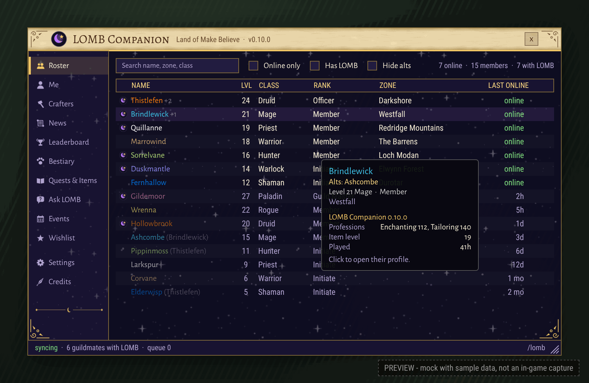
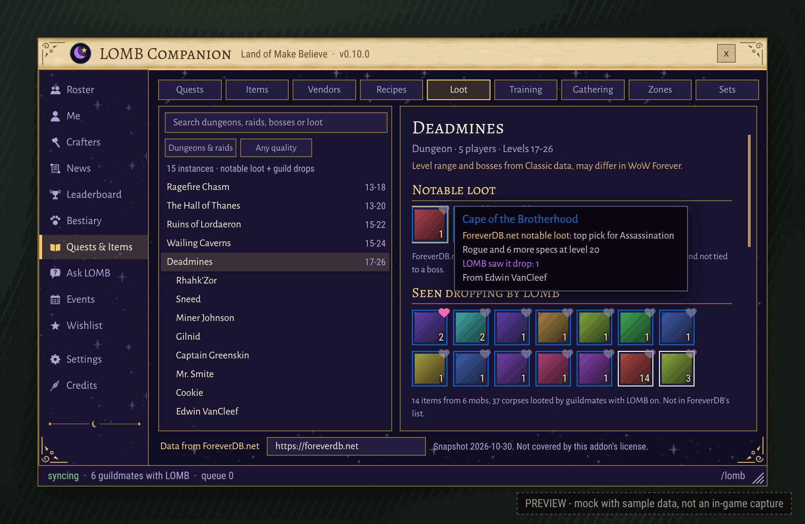
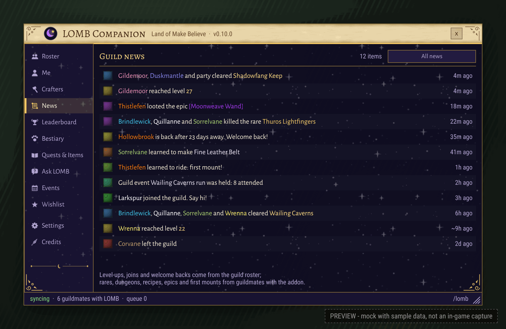
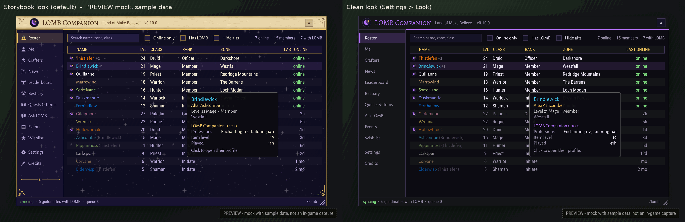

# LOMB Companion

**A free guild addon for Land of Make Believe in WoW: Forever: roster, crafters, news, a guild bestiary, quest and loot info, and events, all in one window.**

> **Status:** v0.10.0, ready for WoW: Forever launch Nov 4; not yet tested in the live game.

**[⬇ Download the newest release](https://github.com/lomb-hana/lomb-app/releases)** (the `LOMBCompanion-v….zip` at the top) · **[📘 Install guide](docs/INSTALL.md)** (two minutes)

## What it does

- **Roster:** every member with level, class, rank, zone and last seen, even those without the addon.
- **Me & Profiles:** your stats and loot, and each member's gear, professions, alts and main.
- **Crafters:** "who can craft this?" search, plus crafters right on item tooltips.
- **News & Leaderboards:** level-ups, rare kills, dungeon clears, epic loot and fun weekly boards.
- **Bestiary:** what the guild has met and seen drop, with rare alerts from guildmates.
- **Quests & Items:** quests, items, vendors, recipes, class training, gathering and a Loot browser for dungeons and raids, from [ForeverDB.net](https://foreverdb.net).
- **Ask LOMB:** type a question like "where do I turn in this quest?" and get an answer from the data above.
- **Events & Wishlist:** guild events with attendance, and a list of what members need or can give away.

Open it with the minimap button or `/lomb`. It comes in a storybook look made for the guild, with a plainer Clean look in Settings.

| Loot browser | News |
|---|---|
|  |  |

**[See every screenshot →](docs/SCREENSHOTS.md)** All of them are previews with sample data, not in-game captures.

## Check it works, or report a bug

Type **`/lomb test`**. Every line should say PASS. If something says WARN or FAIL, or you get a red error pop-up:

1. In the test window, click **Select all** and press Ctrl+C.
2. Post it in the guild's addon channel on Discord, with the error text if there was one and a line about what you were doing.

More in the [install guide](docs/INSTALL.md#something-broke). What changed in each version is in the [changelog](CHANGELOG.md).

## Privacy

- Everything is saved on your own computer, in the game's normal addon files. Nothing is uploaded anywhere; addons can't go online.
- Members' levels, gear and professions are shared only with your own guild, over the game's hidden guild addon channel.
- You can turn sharing off in Settings, as well as rare alerts (which share where you spotted the rare) and event attendance.
- The wishlist shares only what you add. The bank ledger is off unless someone ticks "This is a guild bank character".
- Ask LOMB never sends your questions anywhere.

## Credits

- **Quest, item, vendor, profession and dungeon data:** [ForeverDB.net](https://foreverdb.net), used with their approval. Data from ForeverDB.net · https://foreverdb.net. Their work keeps this project going, so if the addon helps you, please **[support ForeverDB.net](https://buymeacoffee.com/foreverdb)**. Their data stays theirs: it isn't covered by this repo's license.
- **Bestiary sightings, kills and drops:** recorded in game by Land of Make Believe members.
- **World of Warcraft and WoW: Forever** belong to Blizzard Entertainment. This is a fan-made guild addon, not affiliated with or endorsed by Blizzard Entertainment (and neither is ForeverDB.net).
- **Code:** MIT licensed, see [LICENSE](LICENSE).

**For developers:** `bash tests/run.sh` runs the offline tests (Lua 5.1), `luacheck LOMBCompanion tests` lints, and `bash tools/build.sh` builds `dist/LOMBCompanion-v<version>.zip` from committed files only.
